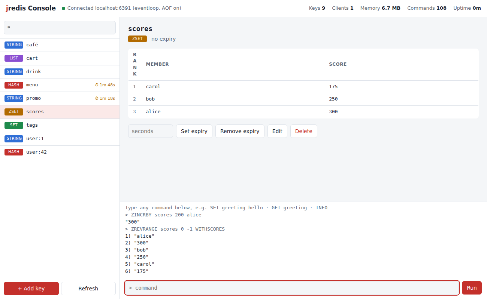

# jredis


jredis is a Redis-compatible in-memory data store written from scratch in Java, with no runtime dependencies. It speaks the real Redis protocol, so the official `redis-cli`, `redis-benchmark` and Redis client libraries work against it unchanged.

I built it to understand how an in-memory database works inside: wire protocols, data structures, expiry, durability, and the single-threaded event loop that makes Redis fast.



## Features

- **RESP protocol**: an incremental parser that handles TCP fragmentation, pipelining, binary-safe values, and inline commands typed in `nc`/`telnet`.
- **90 commands** across the five Redis types: strings, lists, hashes, sets and sorted sets ([full list](docs/COMMANDS.md)).
- **Hand-built data structures**: a skip list with rank spans (sorted sets), a circular-buffer list (O(1) at both ends and by index), and an O(1) random-sampling TTL index.
- **Key expiry** with lazy and active expiration, using the same sampling algorithm as Redis.
- **Persistence**:
  - an append-only file with `always`, `everysec` or `no` fsync, crash-tail repair and compaction (`BGREWRITEAOF`);
  - checksummed binary snapshots (`SAVE`), written atomically.
- **Two server designs behind one flag**: a single-threaded NIO event loop (the default, like Redis) and thread-per-client. Both pass the same test suite.
- **Web console** for non-engineers: browse and search keys, add and edit values with forms, watch TTL countdowns, run commands. It is served by a small HTTP-to-RESP bridge.
- **Benchmarks**: a built-in load generator, plus measured results from `redis-benchmark` ([docs/BENCHMARKS.md](docs/BENCHMARKS.md)).

## Quick start

The build uses a Java 25 toolchain; Gradle downloads it automatically if it is missing. The code itself only needs Java 21. In a GitHub Codespace on this repo everything is preinstalled, including `redis-cli`.

```bash
# 1. Start the server (terminal 1)
./gradlew run --args="--port 6380"

# 2. Talk to it with the real Redis CLI (terminal 2)
redis-cli -p 6380
127.0.0.1:6380> SET drink "double double"
OK
127.0.0.1:6380> SET promo "free donut" EX 60
OK
127.0.0.1:6380> TTL promo
(integer) 60
127.0.0.1:6380> ZADD scores 100 alice 250 bob
(integer) 2
127.0.0.1:6380> ZREVRANGE scores 0 -1 WITHSCORES

# ...or with plain netcat, using inline commands
printf 'PING\r\nGET drink\r\n' | nc localhost 6380

# 3. Start the web console (terminal 3), then open http://localhost:8080
./gradlew run --args="console --target localhost:6380 --http 8080"

# 4. Benchmark
redis-benchmark -p 6380 -q -t set,get -n 100000
./gradlew run --args="bench --target localhost:6380"
```

### Server options

| Flag | Default | Meaning |
|---|---|---|
| `--port` | `6380` | TCP port |
| `--mode` | `eventloop` | `eventloop` (one thread, NIO) or `threads` (thread per client) |
| `--dir` | `.` | Folder for `appendonly.aof` and `dump.jrdb` |
| `--appendonly` | `yes` | Log every write to the append-only file |
| `--appendfsync` | `everysec` | `always`, `everysec` or `no` |
| `--save-on-shutdown` | `yes` | Write a snapshot on Ctrl+C |

## Tests

```bash
./gradlew test
```

There are 44 tests:

- **Unit tests:** parser fragmentation and garbage input, skip-list property tests against a `TreeMap`, expiry with a fake clock, and every command family.
- **Persistence tests:** snapshot round trip, bit-flip corruption detection, AOF replay, crash-tail truncation, and rewrite.
- **End-to-end tests:** these use real sockets and run against **both** server designs. They cover pipelining, 20 concurrent clients with no lost updates, inline commands, protocol errors, and data surviving a restart.

## How it works

```
 redis-cli / app ──TCP──▶ EventLoopServer ──▶ RespParser ──▶ CommandTable ──▶ Database
                          (one thread,          (bytes →       (lookup, arity,   (HashMap + TTL index,
                           NIO Selector)         commands)      run handler)       skip list, lists...)
                                 ▲                                     │
                                 └──────── replies ◀── AOF flush ◀─────┘  (write is logged before the reply)
```

Read more:

- [docs/ARCHITECTURE.md](docs/ARCHITECTURE.md): the request lifecycle, data structures, persistence, and the concurrency model.
- [docs/DECISIONS.md](docs/DECISIONS.md): the design decisions, with the alternatives considered.
- [docs/BENCHMARKS.md](docs/BENCHMARKS.md): measured throughput and latency.
- [docs/DEV-LOG.md](docs/DEV-LOG.md): every setup step and why.

## Known limitations

- Single database (`SELECT 0` only), and no transactions (`MULTI`/`EXEC`), pub/sub, Lua scripting, replication or clustering.
- `KEYS` scans every key. On a large dataset it blocks the event loop, just as it does in Redis. `SCAN` is not implemented.
- `SAVE`/`BGSAVE` and `BGREWRITEAOF` run in the foreground. Real Redis forks a child process so the server keeps serving; the JVM cannot fork.
- No authentication, memory limit or eviction policy. The web console binds to localhost for that reason.
- Values are stored as Java strings: one char per byte, which is binary-safe but uses about twice the memory of a byte array.

## What I learned

- **TCP is a byte stream.** A parser must cope with half a command or ten commands arriving in one `read()`.
- **Why Redis is single-threaded.** One thread with non-blocking I/O avoids locks entirely, and the measurements in [BENCHMARKS.md](docs/BENCHMARKS.md) show it beating thread-per-client.
- **Durability is a spectrum.** fsync policy trades safety for speed, and logging the absolute expiry time (not "10 seconds from now") is what makes replay correct.
- **Measure before optimizing.** Buffering replies in the threaded server roughly doubled pipelined GET throughput. Finding that took a benchmark, not a guess.

## Built with

Java standard library only: `java.nio` for networking and `com.sun.net.httpserver` for the console. Gradle and JUnit 5 for build and tests. Developed with AI assistance (Claude) as a learning project.
